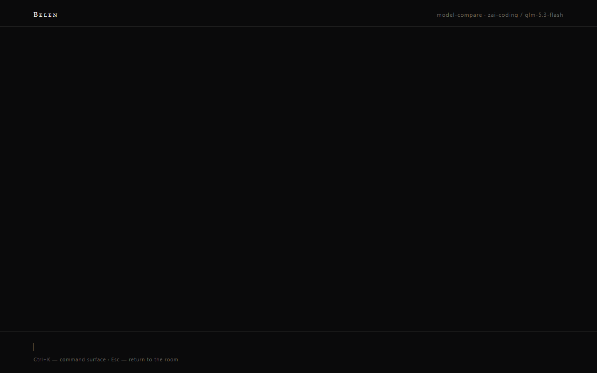

# BELEN

**The interface is the conversation.**



BELEN is a native Windows and macOS (Apple Silicon) room where you type, the model answers, and the answer becomes the tool you need. A single continuous typographic surface — no bubbles, no cards, no avatars, no sidebar. Provider-agnostic, local-first, portable.

## Highlights

- **One room, not a chat client.** Blocks (`user`, `assistant`, `tool`, `artifact`, `worker`, `system`) scroll as one document; the speaker is typography, chrome is summoned (`Ctrl+K`, `⌘K` on Mac) and dismissed (`Esc`).
- **BUI — the answer that becomes a tool.** The model streams text *and* declarative JSON components (tables, charts) that render inline, sortable and pinnable, before the sentence finishes. Unknown components degrade to text; nothing breaks the page.
- **Bring your own provider.** OpenAI-compatible endpoints, Anthropic, Google, Ollama, LM Studio — keys stored locally, encrypted with DPAPI on Windows, the login Keychain on macOS.
- **Tools, on from the start.** She knows the date and time. Web search and page reading, file tools and commands (PowerShell on Windows, zsh on macOS) work from the first run — in your home folder, or a workspace you choose in Settings → Chat — and by default each command and file change waits for you in the room, showing exactly what it would do. Switch any class off in Settings → Chat. Web search needs no key: it reads Bing's results page under the app's own name, and says so when the engine refuses.
- **Cordis-spined plugin runtime.** Skills and plugins load from manifests via a reversible-effect kernel (Context · Fiber · Service) that runs inside the webview (WebView2 on Windows, WKWebView on macOS) — no Node shipped.
- **Portable.** One folder, no installer, no admin, no registry — `data/` lives beside the executable. ~10 MB.
- **Fast by budget.** Cold start ≤ 400 ms, warm launch ≤ 120 ms, p99 keystroke ≤ 5 ms, zero dropped frames, idle working set ≤ 120 MB — enforced by `pnpm perf` against the real binary.

## Requirements

- Windows 11 + WebView2 Runtime
- macOS 11+ (Apple Silicon)
- Node 24+, pnpm 12+
- Rust 1.98 (MSVC + Visual Studio 2026 Build Tools on Windows, Xcode command-line tools on macOS)

## Quickstart

Windows:

```powershell
pnpm install
powershell -ExecutionPolicy Bypass -File scripts/build.ps1
```

Then run `%USERPROFILE%\.belen-target\debug\belen.exe`.

macOS (Apple Silicon):

```bash
pnpm install
pnpm tauri build --no-bundle
```

Then run `src-tauri/target/release/belen`. A downloaded release `BELEN` is
unsigned — first put it in a writable folder (`~/Apps/BELEN/`, **not**
`/Applications`: `data/` cannot be created there), then:

```bash
chmod +x BELEN
xattr -d com.apple.quarantine BELEN   # only if a browser downloaded it
./BELEN
```

After an update, macOS may ask for Keychain access ("BELEN wants to use your
confidential information…") — choose **Always Allow**, or saved keys cannot
be read.

## Commands

| Command | What it does |
|---|---|
| `pnpm dev` | Vite dev server on `127.0.0.1:1420` |
| `pnpm build` | Production frontend into `dist/` |
| `pnpm test` | Cordis kernel tests (Vitest) |
| `pnpm typecheck` | TypeScript check |
| `pnpm perf` | Launch the real binary in `--perf` mode and print the budget report |
| `pnpm summon` | Measure resident summon latency |
| `pnpm mock` | Local OpenAI-compatible mock provider on `:8787` |
| `pnpm probe` | End-to-end provider probe (discover, test, stream) |
| `scripts/build.ps1` | Debug build (VsDevCmd + machine overrides) |
| `scripts/build.ps1 -Release` | Release build with LTO |
| `scripts/build.ps1 -TauriBuild` | Portable build, no installer |
| `scripts/build.ps1 -Test` | Rust unit tests (DPAPI, updater) |
| `pnpm release init` | Create the update signing keypair (once) |
| `pnpm release sign <BELEN.exe>` | Hash + sign the exe, write `latest.json` |
| `pnpm release publish <exe> [json]` | Upload exe + manifest to the GitHub release |

## Architecture

```
Webview (WebView2 / WKWebView)
├── SolidJS room · BUI renderer · streaming append path
├── Cordis kernel (Context · Fiber · Service · reversible effects)
└── provider / agent / manifest-loader services (proxies)

Rust core
├── Tauri commands + channels
├── key store        → DPAPI on Windows (data/keys/*.dpapi), login Keychain on macOS
├── data root        → data/ beside the executable
└── perf snapshot    → working set, exe size, boot time
```

Cordis's core dependencies are pure TypeScript (`cosmokit`, `@standard-schema/spec`),
so the kernel runs inside the webview without shipping Node. The official
`@cordisjs/plugin-loader` is Node-only and is not used; BELEN has its own
manifest loader.

## Performance budget

| Metric | Target |
|---|---|
| Cold start → JS boot | ≤ 400 ms |
| Warm launch | ≤ 120 ms |
| Keystroke handle (p99) | ≤ 5 ms |
| Dropped frames | 0 |
| Idle working set | ≤ 120 MB |
| Portable folder | ≤ 15 MB |

`pnpm perf` runs the suite against the real binary and exits non-zero on a hard
failure. The debug build is expected to miss the startup target; the release
build is the number that counts.

macOS (Apple Silicon, release build, 2026-11-24): startup median **470 ms**
across 3 runs, keystroke p99 **1 ms**, dropped frames **0**, idle working set
**114.0 MB**, executable **8.9 MB** — all hard gates pass. Summon (second
instance → first window) **72 ms** against the 150 ms gate.

## Portable

Copy `%USERPROFILE%\.belen-target\release\belen.exe` to any folder as `BELEN.exe`.
Data (`config.json`, `belen.db`, `keys/`, `exports/`) is created in `data/` beside it.
No installer, no admin rights, no registry. The portable folder measures **9.8 MB**
with the perf report included.

## Updates

BELEN updates itself, on demand: Settings → About → **Check for updates** (also in
the `Ctrl+K` palette, `⌘K` on Mac). The check fetches a signed manifest
(`latest.json` on Windows, `latest-macos.json` on macOS) from the GitHub
releases, verifies it with an Ed25519 key compiled into the binary, and — after you
confirm — downloads the new build, hash-checks it, swaps it in place and restarts.
`data/` is never touched; debug builds refuse to update.

Cutting a release:

```powershell
# once: pnpm release init  (private key lands in ~/.belen/update-private.pem)
pnpm build
powershell -ExecutionPolicy Bypass -File scripts/build.ps1 -TauriBuild
pnpm release sign %USERPROFILE%\.belen-target\release\belen.exe
pnpm release publish %USERPROFILE%\.belen-target\release\belen.exe
```

Bump the version in `package.json`, `tauri.conf.json` and `Cargo.toml` together —
`sign` refuses to run when they disagree. `BELEN_UPDATE_FEED` points the app at any
other feed (loopback http allowed) for local rehearsals. Releases cover both
platforms — `release sign` / `publish` take `--platform=macos` (`BELEN` →
`latest-macos.json`); Windows publishes first, macOS adds to the same release
(the full loop is in AGENTS.md).

## Repository layout

| Path | Contents |
|---|---|
| `app/` | The Tauri + SolidJS application (see [app/README.md](app/README.md)) |
| `portable/` | Portable-layout data templates |
| `00-discovery-brief.md` … `05-macos-build.md` | Discovery interview, product spec, task breakdown, toolchain notes, auth design, macOS build plan |

## License

[MIT](LICENSE) © 2026 mrlfarano
